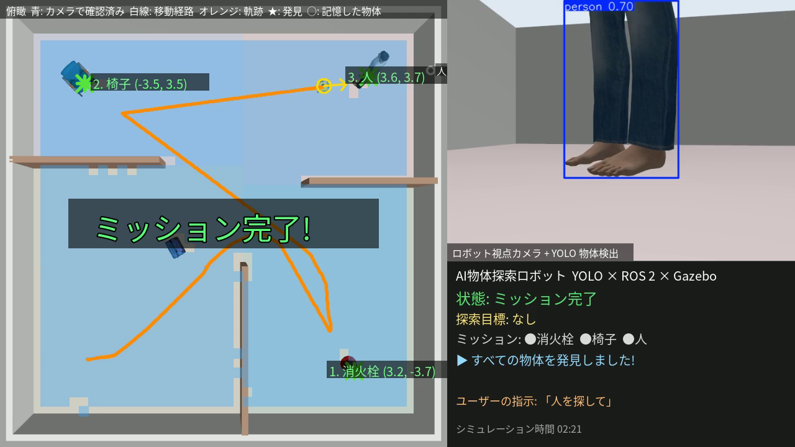

# YOLO物体探索ロボット（ROS 2 × Gazebo × YOLO）

Physical AI 応用1講座 最終課題。

差動二輪ロボットが **カメラ画像をYOLOで推論** し、指定された物体（例：消火栓 → 椅子）を部屋の中から
**自律的に探し出し、近づいて、地図上の位置を記録** します。探索中に見かけた物はすべて記憶するので、
後から日本語で「人を探して」と頼むと、探し回らずにその場所へ直行します。

ベースにしたサンプル：「gazeboとROS2を連携してロボットを操作する」（最終課題サンプル・初級おすすめ）



## サンプルからの発展点

| | ベースのサンプル | 本プロジェクト |
|---|---|---|
| ロボット | SDFの差動二輪 | 同じ構成をもとに自作し、**前方RGBカメラ・360° LiDAR** を搭載 |
| 操作 | キーボードteleopのみ | **YOLOによる自律探索** ＋ キーボードteleop（`m` で手動⇔自動） |
| AI | なし | **YOLO11n（COCO 80クラス学習済み）で物体検出**（推論のみ・CPU） |
| 探索 | なし | カメラで確認済みの範囲を格子地図に記録し、**フロンティア探索** |
| 接近・停止 | なし | 視覚サーボで接近、**LiDAR距離と画像からの単眼距離（地面拘束）を併用**して停止 |
| 記憶 | なし | **意味地図**：見かけた物体をクラス名＋位置で記憶し、後から頼まれたら直行 |
| 指示 | キー入力 | 日本語・英語の指示文（例：`消火栓と椅子を探して`、`止まって`、`手動`） |
| ブリッジ | `/cmd_vel` のみ | 同じyaml方式で `/camera/image_raw` `/scan` `/odom` `/clock` などを追加 |
| 出力 | なし | 発見した物体の位置（`/search/found`）、合成デモ動画 |

## 構成

```
src/yolo_search_robot/
├── models/search_robot/model.sdf    差動二輪ロボット（カメラ・LiDAR付き）
├── worlds/search_arena.sdf          10m×10mの部屋（4エリア）と物体
├── config/bridge.yaml               ros_gz_bridge 設定
├── config/params.yaml               パラメータ（探索目標リストなど）
├── launch/yolo_search.launch.py     一括起動
└── yolo_search_robot/
    ├── yolo_detector_node.py        YOLO推論 → vision_msgs/Detection2DArray
    ├── search_controller_node.py    探索・接近・記憶の状態機械
    ├── exploration_map.py           カメラ確認済み地図、フロンティア検出、BFS経路計画
    ├── keyboard_teleop_node.py      キーボード操作（w/a/s/d、m で手動⇔自動）
    ├── demo_recorder_node.py        デモ動画の合成・録画
    ├── labels.py                    COCOクラス名⇔日本語、指示文の解析
    └── image_utils.py               Image ⇔ numpy 変換
tools/                               録画・動画編集・評価用スクリプト
report/                              説明資料（HTML → PDF）
```

```
 Gazebo ──/camera/image_raw──▶ yolo_detector ──/yolo/detections──▶ search_controller ──/cmd_vel──▶ Gazebo
        ──/scan, /odom, /ground_truth────────────────────────────▶   │  ▲
                                         /search/status, /search/found ◀┘  └── /search/command（指示文）
```

## 動作環境

- Ubuntu 24.04 / ROS 2 Jazzy / Gazebo Harmonic（GPUなし・CPUのみで動作確認済み）
- Ubuntu 22.04 / ROS 2 Humble / Gazebo Fortress 向けに、launchファイルがプラグイン名などを自動で書き換えます（未検証）

## セットアップ

```bash
sudo apt install ros-jazzy-ros-base ros-jazzy-ros-gz ros-jazzy-vision-msgs python3-colcon-common-extensions
pip install ultralytics "numpy<2" "opencv-python<4.12"   # ROS 2 の Python 拡張は NumPy 1.x でビルドされているため
```

YOLOの重み（`yolo11n.pt`）は初回起動時に自動でダウンロードされます（`model:=<パス>` で指定も可）。
部屋に置く物体のモデルは、起動時に Gazebo Fuel から自動で取得されます。

```bash
mkdir -p ~/ws/src && cd ~/ws/src
git clone https://github.com/masamichifujiwara/pai_yolo_search.git
ln -s pai_yolo_search/src/yolo_search_robot .
cd ~/ws && colcon build --symlink-install
source install/setup.bash
```

## 実行

```bash
# Gazebo GUI付き
ros2 launch yolo_search_robot yolo_search.launch.py

# キーボード操作も使う（xterm が開きます。m で手動⇔自動）
ros2 launch yolo_search_robot yolo_search.launch.py teleop:=true

# GUIなしでデモ動画を録画
ros2 launch yolo_search_robot yolo_search.launch.py headless:=true record:=true video:=$HOME/demo.mp4
```

実行中に指示を出す例：

```bash
ros2 topic pub --once /search/command std_msgs/msg/String "{data: '人を探して'}"
ros2 topic pub --once /search/command std_msgs/msg/String "{data: '止まって'}"
ros2 topic echo /search/found
```

提出動画は `tools/record_final.sh`（ミッション → 完了後に指示）で録画し、
`tools/make_video.py`（タイトル・説明・2倍速・結果カードの付与）で仕上げました。

## 主なパラメータ（`config/params.yaml`）

| パラメータ | 既定値 | 内容 |
|---|---|---|
| `targets` | `["fire hydrant", "chair"]` | 探す物体（COCOクラス名）と順番 |
| `confidence` / `confirm_frames` | 0.5 / 3 | 目標と判定する信頼度と連続フレーム数 |
| `stop_distance` | 0.9 m | 物体の手前で止まる距離 |
| `use_frontier` | true | フロンティア探索（false で簡易探索） |
| `pose_source` | `ground_truth` | 自己位置：シミュレータの真値（実機ではSLAM/AMCLに相当）または `odom` |

## ライセンス・クレジット

- コード：MIT License
- 物体モデル：Gazebo Fuel（OpenRobotics）のモデルを起動時に取得して使用
- 物体検出：Ultralytics YOLO11（AGPL-3.0）
